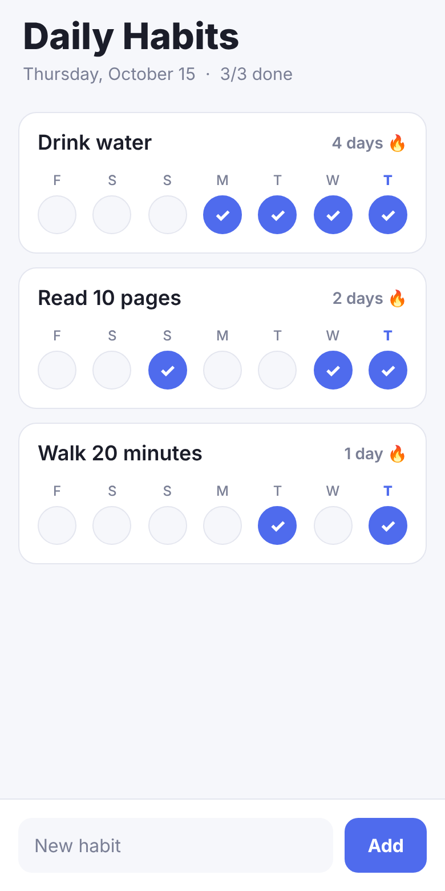

# Daily Habits

A tiny habit tracker for iOS and Android, built with [Expo](https://expo.dev) (React Native).

- Add habits, tap a day to check it off (last 7 days shown)
- Shows your current streak for each habit
- Long-press a habit to delete it
- All data stays on the device (no account, no network, no tracking)



## Run it locally

```bash
cd mobile-app
npm install
npx expo start
```

Scan the QR code with the **Expo Go** app on your phone (App Store / Play Store) to try it instantly.

## Publish to the App Store and Google Play

Builds happen in the cloud with **EAS**, so you do **not** need a Mac or Android Studio.

### 0. One-time accounts

| What | Cost | Link |
| --- | --- | --- |
| Expo account | Free | https://expo.dev/signup |
| Apple Developer Program | $99 / year | https://developer.apple.com/programs/ |
| Google Play Console | $25 once | https://play.google.com/console/signup |

### 1. Before the first build

1. If someone else already owns the IDs, change `ios.bundleIdentifier` and `android.package` in `app.json`
   (currently `com.mannpatel.dailyhabits`). They must be unique and **cannot change after publishing**.
2. The app icon is in `assets/` (sources and export notes in `assets/source/`). To change it, edit the SVGs and re-export.
3. Host the privacy policy (`../privacy.html` in this repo, e.g. via GitHub Pages) — both stores ask for its URL.

### 2. Log in and link the project

```bash
npx eas-cli@latest login
npx eas-cli@latest init        # creates the project on expo.dev and adds its ID to app.json
```

### 3. Build

```bash
npx eas-cli@latest build --platform android --profile production   # .aab for Google Play
npx eas-cli@latest build --platform ios --profile production       # .ipa for the App Store
```

EAS asks to generate signing keys/certificates for you — answer **yes**. For iOS it signs in to your Apple Developer account.

Want to test on an Android phone first? `--profile preview` produces an installable `.apk`.

### 4. Submit

```bash
npx eas-cli@latest submit --platform ios       # uploads to App Store Connect / TestFlight
npx eas-cli@latest submit --platform android   # uploads to Google Play Console
```

- **Google Play:** the very first upload must be done by hand: create the app in Play Console and upload the `.aab`
  from step 3 under *Testing → Internal testing*. After that, `eas submit` works (it needs a Google service-account
  key; see https://docs.expo.dev/submit/android/). New personal developer accounts must run a closed test with
  testers for 14 days before going to production.
- **App Store:** `eas submit` creates the App Store Connect record. Then fill in the listing in App Store Connect and
  press *Submit for Review*.

### 5. Store listing checklist

- App name, short and full description
- Screenshots (iPhone 6.9" and Android phone, at minimum)
- Privacy policy URL
- **Data safety (Google) / App Privacy (Apple):** answer *"No data collected"*. The app stores everything on the device only.
- Content rating questionnaire (Google) / age rating (Apple): no objectionable content → 4+ / Everyone
- Category: *Health & Fitness* or *Productivity*

### Releasing an update

Bump `version` in `app.json` (e.g. `1.0.1`), plus `ios.buildNumber` and `android.versionCode` (each store rejects a
build number it has already seen), then build and submit again.
